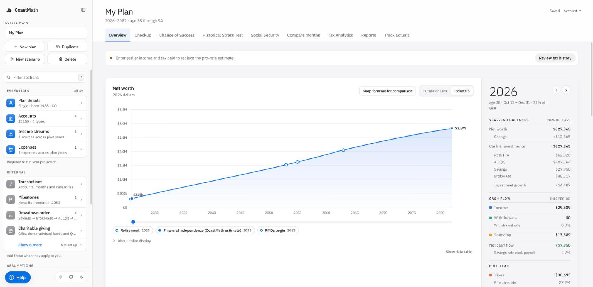
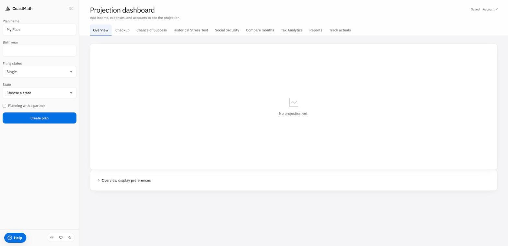
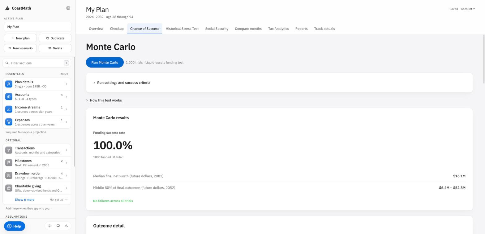

# CoastMath

A retirement and financial planner that models every year from your next
paycheck to your last withdrawal: federal, state and local taxes, accounts and
withdrawal order, Social Security, healthcare, Monte Carlo and historical
stress tests, scenarios, and your actual spending from imported transactions.

This repository is the whole planner: the calculation engine, the API and the
web app. It runs as one container that stores everything in a single SQLite
file.



## Run it

Pick one:

| Path | Needs | Use it for |
|---|---|---|
| [Docker](#with-docker) | Docker with Compose | Running CoastMath for yourself |
| [Without Docker](#without-docker) | Python 3.14, Node 22 | Running it without containers |
| [Development](#development-with-hot-reload) | Python 3.14, Node 22 | Changing the code |

### With Docker

```sh
git clone https://github.com/blank-slate-labs/coastmath.git
cd coastmath
docker compose up --build -d
```

Open http://localhost:8000. Port 8000 taken? Start it with
`COASTMATH_PORT=8001 docker compose up --build -d` instead, or set
`COASTMATH_PORT` in `.env` (copy `.env.example`; every setting has a default).

The database and the secrets the server generates on first start live in the
Docker volume `coastmath_coastmath_data`, so `docker compose down` and `up`
keep your plans. **`docker compose down -v` deletes that volume**, plans and
all. `docker compose logs -f` follows the server log.

The server answers on this machine only. To use it from other devices, read
[Reaching it from other machines](#reaching-it-from-other-machines) first.

### Without Docker

```sh
git clone https://github.com/blank-slate-labs/coastmath.git
cd coastmath

cd frontend
npm ci --legacy-peer-deps
npx vite build                      # writes the web app to backend/static

cd ../backend
python3.14 -m venv venv
venv/bin/pip install -r requirements.txt
export DATABASE_URL=sqlite:///./coastmath.db SESSION_COOKIE_SECURE=false
venv/bin/uvicorn app.main:app --port 8000
```

Open http://localhost:8000. The database and its generated secrets
(`coastmath.db.secrets.json`) are created in `backend/`. Rerun `npx vite build`
after pulling a new version.

### Development with hot reload

Two terminals. The API, from `backend/` after the steps above:

```sh
export DATABASE_URL=sqlite:///./coastmath.db SESSION_COOKIE_SECURE=false
venv/bin/uvicorn app.main:app --port 8000 --reload
```

The web app, from `frontend/`:

```sh
npm run dev -- --port 3000
```

Open http://localhost:3000. Vite forwards `/api` to port 8000; with the API on
another port, set `VITE_API_PROXY_TARGET=http://localhost:<port>`. Use port
3000, or add your port to `ALLOWED_ORIGINS`.

### First run

**Accounts are browser sessions.** The first visit from a browser creates an
account for that browser; there is no sign-in. Plans belong to that session
cookie, which lasts 30 days and renews on each visit. Clearing the browser's
cookies for the site loses access to its plans, and a second browser starts
its own account. `localhost` and `127.0.0.1` are separate sites, so each has
its own account.

The first visit opens on a blank plan. Enter a birth year and state, then
**Create plan**:



Fill in the sidebar's Essentials (accounts, income streams, expenses) to run
the projection. The **Success odds** tab runs a Monte Carlo test:



The CoastMath iPhone app connects only to the hosted service, not to a
self-hosted server.

### Troubleshooting

| Symptom | Fix |
|---|---|
| `curl http://localhost:8000/api/ready` doesn't return `{"status":"ready",…}` | The server isn't up: check `docker compose logs` or the uvicorn output. |
| Address already in use | Another program has port 8000. Use `COASTMATH_PORT` (Docker) or `--port` (uvicorn). |
| Plans disappear after a reload | The browser dropped the session cookie. Over plain HTTP, `SESSION_COOKIE_SECURE` must be `false`. |
| http://localhost:8000 returns `{"error":{"code":"NOT_FOUND",…}}` | The web app wasn't built. Run `npx vite build` in `frontend/`, then restart the server. |
| Behind an HTTPS proxy, every save fails with 403 `ORIGIN_INVALID` | The server doesn't trust the proxy's headers, so it sees `http://` and refuses the `https://` origin. Set `FORWARDED_ALLOW_IPS` to the proxy's address (see [Reaching it from other machines](#reaching-it-from-other-machines)). |
| `python3.14: command not found` | Install Python 3.14 (python.org or your package manager). Older versions are not supported. |

## Configuration

Settings are environment variables. Each way of running reads them from a
different place:

- **Docker Compose** reads `.env` next to `docker-compose.yml` (copy
  `.env.example`, which lists every setting except `DATABASE_URL` and
  `VITE_TRANSACTIONS_ENABLED`; `docker-compose.yml` sets those).
- **uvicorn** reads `backend/.env` and the shell environment. `COASTMATH_PORT`
  and `COASTMATH_BIND` are Compose settings; with uvicorn use `--port` and
  `--host`.

| Variable | Default | Effect |
|---|---|---|
| `DATABASE_URL` | `sqlite:////data/coastmath.db` in the image | The SQLite file. Its schema is created or upgraded at startup. The file is created readable by the server's user only. |
| `SESSION_SECRET` | generated | Signs session cookies. Generated on first start into `<database>.secrets.json` unless set. At least 32 characters. |
| `LEDGER_ENCRYPTION_KEY` | generated | Encrypts stored SimpleFIN and Plaid credentials. Generated like `SESSION_SECRET` unless set. `LEDGER_ENCRYPTION_KEYS_PREVIOUS` keeps older keys readable after a change. |
| `SESSION_COOKIE_SECURE` | `false` in Compose | `true` once the site is served over HTTPS. Over plain HTTP it must be `false`, or browsers drop the session cookie. |
| `ALLOWED_ORIGINS` | `http://localhost:3000` | Other origins that may call the API with cookies. The serving origin is always allowed; `*` and `null` are refused at startup. |
| `FORWARDED_ALLOW_IPS` | `127.0.0.1` | Proxy addresses whose `X-Forwarded-*` headers are trusted, as the server sees them. Set it when a reverse proxy terminates HTTPS. |
| `TRANSACTIONS_ENABLED` | `true` in Compose | Transactions: imports, connections and month comparisons. Off, they can still be viewed and deleted. |
| `VITE_TRANSACTIONS_ENABLED` | `true` in Compose | Build argument that shows the Transactions section in the planner. |
| `WEB_CONCURRENCY` | `1` | Server processes. One is enough for a household; SQLite allows one writer at a time. |
| `ENGINE_CONCURRENCY` | `4` | Projections each server process runs at once; more are refused with 429. |
| `ENABLE_API_DOCS` | off | Serves the OpenAPI schema at `/openapi.json` and `/docs`. |
| `ENABLE_STATELESS_API` | off | Mounts `POST /api/simulate/stateless` and `/api/compare/stateless`, which project a plan sent in the request body with no session. For local tooling and tests. |
| `APP_REVISION` | unset | Reported as `revision` by `GET /api/ready`, for example the commit you deployed. |
| `COASTMATH_PLUGINS` | unset | Extension modules loaded at startup, comma-separated. Unset or empty loads none. |

### Reaching it from other machines

Compose publishes the port on `127.0.0.1` only. Anyone who can reach the port
gets an account, and over plain HTTP the session cookie travels in clear text
(so does everything you type). Before opening it to your network:

1. Put a reverse proxy that terminates HTTPS in front of it (Caddy, nginx,
   Traefik) and forward to `127.0.0.1:8000`.
2. Set `SESSION_COOKIE_SECURE=true` in `.env`.
3. Set `FORWARDED_ALLOW_IPS` to the proxy's address **as the container sees
   it**. A proxy running on the Docker host arrives from the Docker bridge
   gateway (`172.17.0.1` by default), a proxy in another container from its
   network (`172.16.0.0/12` covers Docker's default ranges). Without this the
   server sees `http://` requests, treats the `https://` origin as foreign and
   refuses every save with 403 `ORIGIN_INVALID`.
4. Only if the proxy runs on another machine: set `COASTMATH_BIND=0.0.0.0` in
   `.env` so the port is published on every interface, and restrict it with a
   firewall to that proxy.

## Transactions

Imported transactions feed the spending in a plan and the month-by-month
comparison against it. Three sources, each optional:

- **Files**: CSV and OFX/QFX exports from a bank. No keys needed.
- **SimpleFIN** (`SIMPLEFIN_ENABLED`, on in Compose): each user pastes a setup
  token from their own [SimpleFIN Bridge](https://www.simplefin.org/)
  account. Accounts sync every 12 hours; bridges allow about 24 requests a day
  per connection. `SIMPLEFIN_ALLOWED_HOSTS` lists the bridge hosts tokens may
  point to.
- **Plaid** (`PLAID_ENABLED`): uses your own keys. Create an application in the
  Plaid Dashboard and set `PLAID_CLIENT_ID`, `PLAID_SECRET` and `PLAID_ENV`
  (`sandbox` works at once with Plaid's test banks; `production` needs Plaid's
  approval, and Plaid bills the key holder per connected login).
  - Banks that sign in through OAuth need `PLAID_REDIRECT_URI`
    (`https://<your host>/plaid/oauth`), also added in the Plaid Dashboard.
  - `PLAID_WEBHOOK_URL` (`https://<your host>/api/ledger/webhooks/plaid`) syncs
    as soon as Plaid has news; without it, connections sync on a schedule.
  - `PLAID_COUNTRY_CODES` (default `US`) sets the countries Link offers.

`GET /api/ledger/providers` reports which sources are offered and why one isn't.

Credentials are stored encrypted, and raw provider data is never stored or
logged. Transactions are kept for about 25 months. Disconnecting a Plaid
connection or deleting an account removes the Plaid login at Plaid first.

### Category suggestions

Transactions that arrive without a category can get one from any
OpenAI-compatible chat completions endpoint, hosted or local:

```sh
LEDGER_LLM_ENABLED=true
LEDGER_LLM_BASE_URL=http://host.docker.internal:11434/v1   # e.g. a local Ollama
LEDGER_LLM_MODEL=<model name>
LEDGER_LLM_API_KEY=                                        # if the endpoint needs one
```

`host.docker.internal` is the Docker host seen from inside the container;
`docker-compose.yml` maps it with `extra_hosts`, which Linux needs and Docker
Desktop ignores.

A suggestion never replaces a category the user chose; the user accepts it in
the transaction review. Each request sends only the description, merchant,
direction, amount rounded to a whole unit and the provider's category text:
no account names, numbers, institutions or dates. A hosted model provider
receives that text under its own terms; a local model keeps it on your
hardware. `LEDGER_LLM_TIMEOUT_SECONDS` (default 30) limits each request.

## Data and backups

The data volume (`coastmath_coastmath_data`; `docker volume ls` shows it)
holds:

- `coastmath.db` (with `coastmath.db-wal` and `coastmath.db-shm` while running).
- `coastmath.db.secrets.json`, the generated keys. Without it, every session
  signs out and stored bank connections must be reconnected.

The encryption key and the credentials it encrypts sit side by side in that
volume, so a copy of the volume is a readable copy of every stored bank
connection. Keep backups as private as the server.

Transactions › **Download CSV** exports the transactions inside the retention
window, and the Exports tab downloads plan results. Neither can be imported
back as a plan; back up the volume for that.

Back up both files with the server stopped (the container has no `sqlite3`
command, and the volume isn't a directory on the host):

```sh
docker compose stop
docker run --rm -v coastmath_coastmath_data:/data -v "$PWD":/backup alpine \
  tar czf /backup/coastmath_backup.tgz -C /data coastmath.db coastmath.db.secrets.json
docker compose start
```

Or copy a running database with SQLite's online backup, which the image's
Python provides:

```sh
docker compose exec coastmath python -c "import sqlite3; s = sqlite3.connect('/data/coastmath.db'); d = sqlite3.connect('/tmp/backup.db'); s.backup(d); d.close()"
docker compose cp coastmath:/tmp/backup.db ./coastmath_backup.db
docker compose cp coastmath:/data/coastmath.db.secrets.json ./coastmath_backup.db.secrets.json
```

To restore, stop the container and unpack the archive into the volume the same
way (`tar xzf /backup/coastmath_backup.tgz -C /data`), which keeps the files
owned by the server's user; files copied in with `docker compose cp` end up
owned by root and the server can't write them. Then start it. To upgrade, pull the new version and run `docker compose up --build`;
the schema migrates on startup. `docker compose down` keeps the volume;
`docker compose down -v` deletes it.

## Development

```sh
cd backend
venv/bin/pip install -r requirements.txt -r requirements-dev.txt
venv/bin/python -m pytest tests/ -q

cd ../frontend
npm run lint
npm run typecheck
npm test
```

`TEST_SQLITE_DIR=<dir>` runs the backend tests on database files instead of
in memory. A model change needs an SQLite migration: the commands are in
`backend/sqlite_alembic.ini`, and a test fails until the migrations and the
models match.

Engine rules and figures live in `backend/coastmath/`; each statutory value in
`backend/coastmath/data/` cites its source in the data itself. The sources and
their licences are summarized in [NOTICE.md](NOTICE.md).

## License

Copyright 2026 Blank Slate Labs. Source-available under the
[PolyForm Noncommercial License 1.0.0](LICENSE).

- **Allowed:** personal use, self-hosting for yourself and your household,
  study, modification, and use by noncommercial organizations, as the license
  defines them.
- **Not allowed without a separate license:** any commercial use, including
  selling CoastMath, offering it as a paid or ad-supported service, or using it
  in a business. For a commercial license, write to hi@blankslatelabs.dev.
- **But also:** I can't stop you 🤷

The CoastMath name and logo are not licensed for use by modified versions or
other products.

Pull requests are not accepted at this time; issues are welcome. See
[CONTRIBUTING.md](CONTRIBUTING.md).
